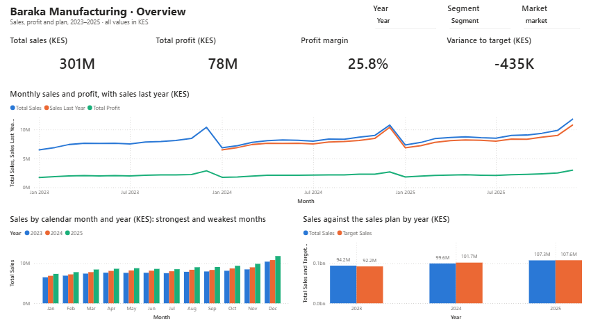
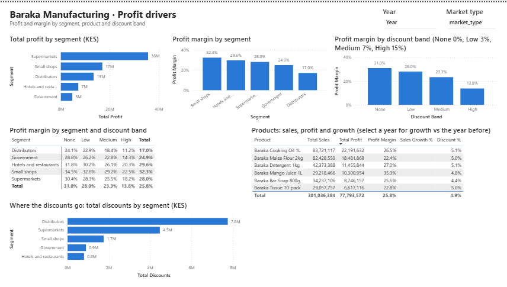
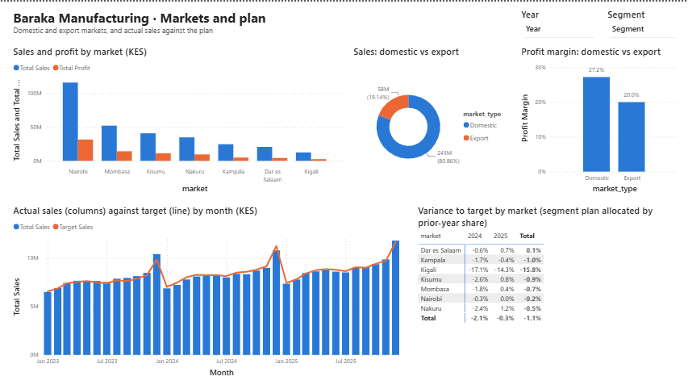
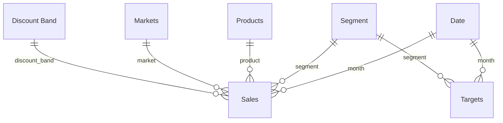

# Baraka Financial Performance Dashboard (Power BI)


An interactive Power BI report for **Baraka Manufacturing** (fictional), a Kenyan maker of cooking oil, flour, soap, detergent, juice and tissue. It shows the CFO where profit is made and lost: sales, discounts, cost and profit by segment, market, product and month, compared with last year and with the sales plan, for January 2023 – December 2025.

| Deliverable | Where |
|---|---|
| Power BI project: star schema, DAX date table, measure library, three-page report | [`BarakaFinance.pbip`](BarakaFinance.pbip) (save as `.pbix`, see below) |
| One-page note for the CFO: three findings and three recommendations, each tied to a chart | [`reports/cfo_note.md`](reports/cfo_note.md) |
| Model design, hidden columns and why | [`docs/model.md`](docs/model.md) |
| All DAX measures | [`docs/measures.md`](docs/measures.md) |
| Page-by-page visual list | [`docs/report-guide.md`](docs/report-guide.md) |
| Expected numbers to check the report against | [`docs/checkpoint_values.md`](docs/checkpoint_values.md) |

---

## Open the report and save the .pbix

The project is saved in Power BI's text-based **PBIP** format, so every table, relationship, measure and visual can be reviewed in git. It opens in **Power BI Desktop** (Windows) like a normal file.

1. **Get the files.** Clone or download this repository. The simplest location is `C:\baraka-financial-performance-dashboard`, which is the folder the model expects by default.
2. **Open** `BarakaFinance.pbip` in Power BI Desktop.
3. **If you saved the repository somewhere else:** go to **Home → Transform data → Edit parameters**. Set **DataFolder** to your repository's `data` folder, with a trailing backslash (for example `D:\projects\baraka-financial-performance-dashboard\data\`).
4. Click **Home → Refresh**. The cards should show **Total Sales 301,036,384** and **Total Profit 77,793,572** (the full list is in [`docs/checkpoint_values.md`](docs/checkpoint_values.md)).
5. **File → Save as** → choose *Power BI file (.pbix)* to get the file to submit.
6. Take a screenshot of each page into [`screenshots/`](screenshots/), or use **File → Export → Export to PDF**.

> If Power BI says the project uses preview features, enable **File → Options and settings → Options → Preview features → Power BI Project (.pbip) save option** and **Store reports using enhanced metadata format (PBIR)**, then reopen.

## Report pages at a glance

| Overview | Profit drivers | Markets and plan |
|---|---|---|
|  |  |  |

## The model



- **Power Query** loads the four CSV files, with explicit types: `month` as Date, money and units as Whole number, and names as Text.
- **Date** is built in DAX with `CALENDAR(2023-01-01, 2025-12-31)` plus Year, Quarter, Month and Month Start columns, and is **marked as the date table**.
- **Segment** (one row per segment) connects both fact tables: actual sales and the monthly sales plan.
- Every relationship is **one-to-many from dimension to fact**. Keys and raw numbers are hidden, and implicit measures are discouraged, so the report uses only explicit DAX measures.

## Measure library

`Total Sales`, `Gross Sales`, `Total Discounts`, `Discount %`, `Total COGS`, `Total Profit`, `Profit Margin`, `Units Sold`, `Sales Last Year` (SAMEPERIODLASTYEAR), `Sales Growth %`, `Sales YTD` (TOTALYTD), `Target Sales`, `Variance to Target` and `Variance to Target %`. There are also `Profit Last Year`, `Share of All Discounts`, `Sales vs 2023 %`, and a market-level target (`Target Sales (Market)`, `Variance to Market Target %`) that allocates the segment plan to markets by their prior-year share. See [`docs/measures.md`](docs/measures.md) for every formula.

## Report pages

1. **Overview:** KPI cards for sales, profit, margin and variance to target; a monthly sales and profit trend with last year alongside; sales by calendar month; sales against plan; slicers for year, segment and market.
2. **Profit drivers:** profit and margin by segment, product and discount band, and where the discounts go.
3. **Markets and plan:** sales and profit by market, domestic vs export, actual against target by month, and variance to target by market.

## Answers to the business questions

| Question | Answer |
|---|---|
| What does one row of baraka-sales represent? | Sales of one product to one segment in one market in one month, at one discount band. |
| How do the money columns relate? | Gross = units × price; discounts = gross × band rate (0/3/7/15%); sales = gross − discounts; profit = sales − COGS. Row 1: 849 × 347 = 294,603 − 20,622 = 273,981 sales − 193,572 COGS = 80,409 profit. |
| Why shared Date and Segment tables? | The plan is at segment-month grain and sales are much finer, so the two facts can't be related directly without an ambiguous many-to-many link. Shared dimensions filter both the same way. |
| Which columns are hidden, and why? | Fact keys, raw money and unit columns (used only through measures), `sale_id` and sort helpers; see [`docs/model.md`](docs/model.md). |
| Most profitable / lowest-margin segment | **Supermarkets** (KES 35.6M profit) / **Distributors** (17.0% margin). |
| Margin from None to High discount band | **31.0% → 13.8%** overall; it falls 11–14 points within every segment (Distributors 24.1% → 11.2%). |
| Fastest-growing product since 2023 | **Mango Juice 1L**, +139.7% (KES 5.9M in 2023 → 14.1M in 2025). |
| Which markets are behind target, and since when? | **Kigali**: −17.1% (2024) and −14.3% (2025) against its allocated target, after sales fell about 22% year on year from **July 2024**. The business as a whole has been behind plan since **January 2024** (every month of 2024; −0.3% in 2025). |
| Strongest and weakest months | **December** strongest and **January** weakest in all three years. |
| Where does discounting cost the most margin? | **Distributors**: 49.5% of all discounts, 40% of their sales in the High band at 11.2% margin; High-discount exports earn 8.1%. |
| Which segment should get more budget? | **Small shops**: highest margin (32.3%), lowest discount rate (3.2%), fastest growth (+16.0% since 2023), ahead of plan in 2023 and 2025. |
| What would you change in the discount policy? | Cap distributors at Medium (7%) without CFO approval, and stop High discounts on exports: about KES 2.9M more profit over three years at the same volumes. |

## Checking the numbers

`analysis/checkpoints.py` reproduces the report's measures independently in pandas and writes [`docs/checkpoint_values.md`](docs/checkpoint_values.md). The test suite checks:

- the data: row counts, the money identities on every row, and that keys match the dimension tables;
- the model: tables, relationship directions, the marked date table, and that every measure reference exists;
- the report: every field used by every visual exists in the model.

The report JSON was also validated against Microsoft's published Power BI report schemas.

```bash
pip install pandas pytest
python analysis/checkpoints.py
python -m pytest
```

## Project structure

```
├── BarakaFinance.pbip                  # open this in Power BI Desktop
├── BarakaFinance.SemanticModel/        # model in TMDL: tables, Power Query, relationships, measures
├── BarakaFinance.Report/               # report in PBIR: 3 pages, 28 visuals, theme
├── data/                               # the four CSV files and data notes
├── analysis/checkpoints.py             # pandas reproduction of the measures
├── docs/                               # model, measures, report guide, checkpoint values
├── reports/cfo_note.md                 # one-page note for the CFO
├── screenshots/                        # page screenshots (add after opening)
└── tests/                              # data, model and report checks
```

## Data and licence

Synthetic data: Baraka Manufacturing is fictional. The data was generated to follow the layout of Microsoft's Financial Sample workbook, re-set in Kenya, for the DSEAfrica Data Lab project *Financial Performance Dashboard in Power BI*. Code and documentation are released under the [MIT License](LICENSE).
