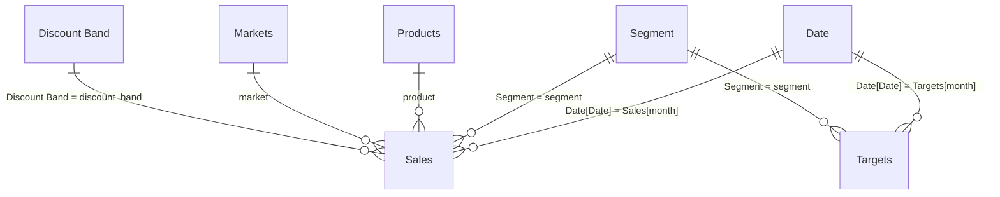

# Data model

A star schema: two fact tables at different grains share conformed dimensions.

Every relationship is **one-to-many from the dimension to the fact table**, with single-direction filtering.

## Tables

| Table | Type | Grain | Built in |
|---|---|---|---|
| `Sales` | Fact | One product, segment, market, month and discount band (6,264 rows) | Power Query from `baraka-sales.csv` |
| `Targets` | Fact | One segment and month (180 rows) | Power Query from `baraka-targets.csv` |
| `Date` | Dimension, **marked as date table** | One day, 1 Jan 2023 – 31 Dec 2025 (1,096 rows) | DAX: `CALENDAR` + `ADDCOLUMNS` (Year, Quarter, Month, Month Number, Month Start, Year Month) |
| `Segment` | Dimension | One segment (5 rows) | Power Query: distinct `segment` values from `Targets` |
| `Products` | Dimension | One product (6 rows) | Power Query from `baraka-products.csv` |
| `Markets` | Dimension | One market (7 rows) | Power Query from `baraka-markets.csv` |
| `Discount Band` | Dimension | One band (4 rows) with its rate and sort order | Power Query `#table`, so slicers and axes sort None → Low → Medium → High |
| `Key Measures` | Measure table | — | Holds all 19 explicit measures |

## Power Query and data types

Every CSV is loaded with `Csv.Document` (UTF-8), headers promoted, then typed explicitly with `Table.TransformColumnTypes(..., "en-US")`, so dates parse the same on any PC:

- `month` → **Date**
- all money and unit columns (`units_sold`, `*_kes`, `sale_id`, `launched`) → **Whole number** (Int64)
- names (`segment`, `market`, `product`, `discount_band`, `category`, …) → **Text**

The folder is a parameter, `DataFolder`, so the model refreshes on any computer once it points at this repository's `data` folder.

Auto date/time is turned off (`__PBI_TimeIntelligenceEnabled = 0`) so the model uses only the explicit Date table, and **Discourage implicit measures** is on, so every number in the report comes from an explicit DAX measure.

## Why do sales and targets need shared Date and Segment tables?

The two fact tables have different grains. Targets exist only per **segment and month**; sales are much finer (product, market, discount band). There is no column that uniquely identifies a row in either table, so a direct relationship would be many-to-many and ambiguous. With shared dimensions, one slicer selection on `Date` or `Segment` filters both facts the same way, and measures such as **Variance to Target** compare like with like. Product, market and discount band filter only `Sales`. That is why **Target Sales** returns blank under those filters instead of a misleading company-wide total.

## Which columns are hidden from report view, and why?

| Hidden | Why |
|---|---|
| `Sales[month]`, `Sales[segment]`, `Sales[market]`, `Sales[product]`, `Sales[discount_band]`, `Targets[month]`, `Targets[segment]` | Foreign keys. Report authors should slice by the dimension columns (`Date`, `Segment`, `Markets`, …) so that one field filters both fact tables consistently. |
| `Sales[units_sold]`, `Sales[sale_price_kes]`, `Sales[gross_sales_kes]`, `Sales[discounts_kes]`, `Sales[sales_kes]`, `Sales[cogs_kes]`, `Sales[profit_kes]`, `Targets[target_sales_kes]` | Raw numbers. They are used only through explicit measures, so nobody drags in an implicit sum, or worse an average of a ratio. |
| `Sales[sale_id]` | Row identifier with no analytical meaning. |
| `Date[Month Number]`, `Discount Band[Band Order]` | Sort-by columns only (they sort `Month` and `Discount Band`). |
| `Key Measures[Value]` | Placeholder column that lets the measure table exist. |

## The market target

The plan is set by segment, not by market. To answer "which markets are behind target", **Target Sales (Market)** allocates each segment-month target to markets by each market's share of that segment's sales in the same month a year earlier. It therefore starts in 2024. A market that loses share against its own history shows as behind plan.
